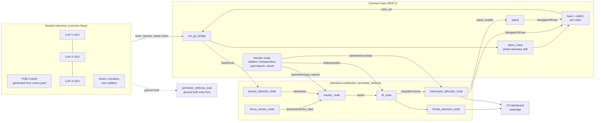

# Autonomous Interception of Physical Threats in Military Perimeters using ROS 2 and Nav2

Master's project (Industry 4.0 / ROS 2, UNSTPB). Three outdoor UGVs patrol a
simulated forward operating base (FOB-3) in Gazebo while own personnel move
around the base. Intruders enter through breaches in the fence and head for the
ammunition depot. The system detects people from on-board sensor data, tells
own personnel from intruders, tracks them with Kalman filters, predicts their
motion and coordinates the robots to intercept them before they reach the
depot.

The project extends the topic of the author's dissertation (an information
system for the analysis, control and processing of security incidents) to the
physical security side.

> Exercise only. All data is simulated. The base, Baza Militară "Căpitan Ion
> Vulturescu" (code name FOB-3, Centrul de Comandă Sector Nord), the officer it
> is named after and its location are fictional and do not correspond to any
> real military site.

## Status

| Milestone | Content | Status |
|---|---|---|
| M1 | Realistic world, generated Nav2 maps, one UGV with Nav2 + AMCL patrolling waypoints | done |
| M2 | Intruder actor, fence sensor, lidar person detector, tracker, IFF, one robot following the track, capture and robot escort to detention, status board; optional soldiers on foot | done |
| M3 | Predictive interception with one robot, naive mode, runtime switch, RViz and dashboard markers | done |
| M4 | Three namespaced robots, role allocation, scenario S1 | planned |
| M5 | Own personnel in authorized zones, threat assessor, false alarm scenario S2 (soldiers, transponders and IFF already in M2) | planned |
| M6 | Multi-target tracking, two intruders, diversion (S3, S4) | planned |
| M7 | Batch evaluation, CSV and plots | planned |
| M8 | C2 web dashboard via rosbridge (first version done: map, symbols, MGRS, entities, SALUTE, alerts with ACK, audit log, replay, night mode); manual intruder control, scenario commands, 3D view | in progress |

## Architecture



The algorithm nodes only use simulated sensor data (lidar, camera, odometry,
transponders). Ground truth poses from Gazebo are used exclusively by the
evaluation package for metrics.

## Packages

| Package | Role | Owner |
|---|---|---|
| `perimeter_defense_world` | `zones.yaml` (single source of truth), world generator, Nav2 map generator, top-down render, textures, actor meshes | common base |
| `perimeter_defense_description` | LUP UGV description (Jackal-sized skid-steer, gpu_lidar, camera) | common base |
| `perimeter_defense_bringup` | Launch files, Nav2 and fleet configuration, RViz | common base |
| `perimeter_defense_sim` | Odometry drift, baseline patrol, scripted intruder, soldiers (transponders, spot reports, escort), exercise truth overlay; later manual intruder | common base |
| `perimeter_defense_viz` | Tactical RViz overlay: aerial background, grid, fence and breaches, objective, zones, routes, fleet symbols, status board | common base |
| `perimeter_defense_gz_plugins` | `ActorDriver` Gazebo system: velocity-driven animated actors (walk, run, stand) | common base |
| `perimeter_defense_msgs` | Detection(Array), Track(Array), PredictedPath(Array), Alert, ThreatLevel, RoleAssignment, Transponder, Custody | shared |
| `perimeter_defense` | Fence sensor processing, lidar person detection, tracking and prediction, IFF, interceptor allocation (threat assessment from M5) | **individual contribution** |
| `perimeter_defense_eval` | Headless batch runs, CSV, plots | M7 |
| `perimeter_defense_dashboard` | C2 web dashboard: C2 state aggregator, web server, web application (Leaflet, milsymbol, mgrs, roslibjs vendored) | common base |

## Nodes and topics (implemented so far)

| Node | Namespace | Subscribes | Publishes |
|---|---|---|---|
| `gazebo` (gz sim) | | `/lupN/cmd_vel` | `/lupN/scan`, `/lupN/odom_wheel`, `/lupN/joint_states`, `/lupN/camera/*`, `/clock` |
| `map_server` | / | | `/map` (navigation map, solid fence) |
| `map_server_localization` | / | | `/map_localization` (AMCL map, fence posts only) |
| `robot_state_publisher` | /lupN | `joint_states` | `/tf`, `/tf_static` (frames `lupN/...`) |
| `odom_noise` | /lupN | `odom_wheel` | `odom`, `/tf` (`lupN/odom` -> `lupN/base_link`) |
| `amcl` | /lupN | `scan`, `/map_localization` | `amcl_pose`, `/tf` (`map` -> `lupN/odom`) |
| Nav2 (controller, planner, behaviors, bt_navigator) | /lupN | `scan`, `odom`, `/map`, `speed_limit` | `cmd_vel`, `plan` |
| `patrol` | /lupN | `patrol_enable` | `navigate_to_pose` goals, `speed_limit` |
| `layout_markers` | / | | `/perimeter/layout_markers` (latched) |
| `intruder_controller` (sim) | / | `/sim/actors/<a>/pose`, `/sim/ground_truth/<r>/pose`, `/threats/tracks`, `/sim/actors/<a>/escort` | `/actor/<a>/cmd_vel`, `/sim/actors/<a>/state` |
| `soldier_controller` (sim) | / | `/sim/actors/<s>/pose`, `/sim/actors/<a>/pose`, `/sim/actors/<a>/state`, `/threats/tracks` | `/actor/<s>/cmd_vel`, `/perimeter/transponders`, `/perimeter/spot_reports`, `/perimeter/custody`, `/sim/actors/<a>/escort` |
| `truth_markers` (sim) | / | `/sim/actors/<a>/pose`, `/sim/actors/<a>/state` | `/sim/truth_markers` (exercise truth overlay) |
| **`fence_sensor`** | / | `/perimeter/breach_<b>/scan` | `/perimeter/fence_alert` |
| **`person_detector`** | / | `/lupN/scan`, `/map`, `/tf` | `/perimeter/detections` |
| **`tracker`** | / | `/perimeter/detections`, `/perimeter/fence_alert`, `/perimeter/spot_reports`, `/threats/neutralize`, `/threats/classification`, `/map` | `/threats/tracks` (10 Hz), `/threats/predicted_paths`, `/threats/markers` |
| **`iff`** | / | `/threats/tracks`, `/perimeter/transponders`, `/perimeter/custody` | `/threats/classification`, `/perimeter/alerts` |
| **`interceptor_allocator`** | / | `/threats/tracks`, `/perimeter/custody`, `/tf` | `/lupN/navigate_to_pose`, `/lupN/patrol_enable`, `/lupN/speed_limit`, `/threats/neutralize`, `/fleet/roles` |

Nodes in bold are the individual contribution. Topics under `/sim/` carry
simulation ground truth and are only used by the scenario scripts and the
evaluation; a unit test checks that the `perimeter_defense` package never
references them.
| `fleet_markers` | / | `/tf` | `/fleet/markers` |
| `c2_state` (dashboard) | / | `/threats/tracks`, `/threats/predicted_paths`, `/fleet/roles`, `/perimeter/*` alerts and custody, `/lupN/odom`, `/lupN/plan`, `/tf` | `/c2/state` (JSON, 4 Hz) |
| `dashboard_server` | / | | HTTP :8080 (web page, `/config.json` from zones.yaml, `/maps/`) |
| `rosbridge_websocket` | / | | websocket :9090 for the browser |
| `status_board` | / | `/threats/tracks`, `/perimeter/fence_alert`, `/perimeter/spot_reports`, `/fleet/roles`, `/perimeter/custody`, `/perimeter/transponders` | `/perimeter/status_board` |

## Environment

Target: Ubuntu 24.04, ROS 2 Jazzy, Gazebo Harmonic (`ros_gz`), Nav2.

```bash
sudo apt install ros-jazzy-desktop ros-jazzy-navigation2 ros-jazzy-nav2-bringup \
  ros-jazzy-ros-gz ros-jazzy-xacro ros-jazzy-rosbridge-server \
  python3-numpy python3-scipy python3-yaml python3-pil python3-matplotlib python3-pytest
```

On WSL2, Gazebo renders the lidar and the camera through OpenGL; use WSLg with
an up-to-date GPU driver for Windows.

## Build

```bash
mkdir -p ~/fob3_ws/src && cd ~/fob3_ws/src
git clone <this repository> ros2-perimeter-interception
cd ~/fob3_ws
rosdep install --from-paths src --ignore-src -y
colcon build --symlink-install
source install/setup.bash
```

## M1: world, map and one patrolling UGV

```bash
# Gazebo GUI + RViz, LUP-1 patrols route R1 at 0.8 m/s
ros2 launch perimeter_defense_bringup m1_patrol.launch.py

# Options
ros2 launch perimeter_defense_bringup m1_patrol.launch.py world_variant:=night
ros2 launch perimeter_defense_bringup m1_patrol.launch.py headless:=true enable_camera:=false
ros2 launch perimeter_defense_bringup m1_patrol.launch.py start_patrol:=false   # drive with RViz "2D Goal Pose"
```

What to check:
- Gazebo: the robot drives the loop (3.5,24.5) -> (14,24.5) -> (13.5,15) -> (3.5,15).
- RViz (tactical view): aerial background, grid, breaches, objective; LUP-1 is shown
  as a blue friendly UGV symbol with call sign, heading and its 10 m detection ring;
  the laser scan (cyan) lines up with the building edges.
- `ros2 topic hz /lup1/scan` gives about 10 Hz.
- Real-time factor in the Gazebo GUI (bottom right) stays close to 1.0.

Check that actors are visible on gpu_lidar in your Gazebo install:

```bash
ros2 run perimeter_defense_world check_actor_lidar     # prints PASS / FAIL
```

Regenerate the world, the maps and the top-down images after editing
`perimeter_defense_world/config/zones.yaml` (run from the package directory):

```bash
cd src/ros2-perimeter-interception/perimeter_defense_world
ros2 run perimeter_defense_world generate_world --zones config/zones.yaml --out worlds --textures models/fob3_textures/textures
ros2 run perimeter_defense_world generate_map --zones config/zones.yaml --out maps/fob3
ros2 run perimeter_defense_world render_ortho --variant day --worlds worlds --models models --out maps/fob3_ortho_day.png
```

Unit tests:

```bash
colcon test --packages-select perimeter_defense_world && colcon test-result --verbose
# or, without ROS:
python3 -m pytest perimeter_defense_world/test
```

## M2: intruder, detection, tracking, IFF, capture and escort to detention

The default base is fully robotic: no people on foot, every person inside
the fence without a transponder is hostile, and the UGV that captures an
intruder escorts him to the detention building. A single UGV patrols the
whole base (`base` loop in zones.yaml: east side, north edge, west side,
south road, centre past the depot) until an alert takes it; with several
UGVs each keeps its sector route. Robots only engage people inside the
fence (an intruder waiting outside is tracked but not chased), never drive
out through a breach and stop following a person who has left the base.

```bash
ros2 launch perimeter_defense_bringup m2_track.launch.py                 # west route, LUP-2
ros2 launch perimeter_defense_bringup m2_track.launch.py route:=east
ros2 launch perimeter_defense_bringup m2_track.launch.py robots:=lup2,lup3
ros2 launch perimeter_defense_bringup m2_track.launch.py soldiers:=true   # with soldiers on foot
ros2 launch perimeter_defense_bringup m2_track.launch.py headless:=true  # RViz only, lighter
ros2 launch perimeter_defense_bringup m2_track.launch.py headless:=true quality:=low  # laptops
```

### Laptops with integrated or software graphics

`quality:=low` (all launch files) loads `fob3_<variant>_lite.sdf`: no shadows
and no decorative tree rows outside the fence (more than half of the visuals).
Sensors, collisions, physics and algorithms are unchanged. Together with
`headless:=true` (no Gazebo GUI, RViz only) this is the lightest setup.
Check the real-time factor while the simulation runs:

```bash
gz topic -e -t /stats -n 3 | grep real_time_factor
```

All timings (intruder `start_delay`, tracker timeouts) are in simulation time,
so with a real-time factor of 0.3 a 15 s delay takes about 50 s on the wall
clock. The intruder publishes `waiting` on `/sim/actors/<name>/state` until it
starts walking.

RViz shows two layers for every person: the ring labelled `EX <NAME> <state>`
with a dotted trail is the exercise truth (where the actor really is, from the
simulator, display "Exercise truth (sim)"; white for the intruder, light blue
for the soldiers); the coloured track (`T1 HOS ...`) is what the defense system
knows from its sensors. Only the second one is used by the algorithms.

The status board east of the base (display "Status board") lists every
contact registered inside the perimeter, from the first report to detention:
track id, class, status (ALERT, TRACKED, LOST, CAPTURED, ESCORTED, DETAINED,
NO CONTACT), how it was first reported (breach sensor, soldier spot report or
lidar), time since registration, speed, distance to the objective, the robot
working on it and the soldier who has it in custody. Below: the robots' roles
and the soldiers' status (patrol, reporting, on the way, escort, transponder).

What happens: the intruder starts outside the fence at (30.5, 27.2) after
`start_delay` seconds, crosses the north breach and walks to the depot
entrance.
- The beam-break sensor at the breach raises `Breach NORTH: perimeter crossed`;
  the tracker creates an ALERT track at the breach (1.5 m uncertainty) and
  LUP-2 leaves its patrol to INVESTIGATE.
- A lidar track tracked for 2 s without a transponder is HOSTILE; it confirms
  the ALERT track (which keeps its id), the intruder starts running and the
  robot switches to FOLLOW.
- A robot within 1 m captures the intruder (CAPTURED) and HOLDs him for 2 s,
  then ESCORTs him at walking pace (0.6 m/s) to the detention building east of
  the vehicle park, waiting whenever he falls more than 3 m behind. It stops
  next to the door, the intruder walks into the cell; when the lidar no longer
  sees him the robot reports him DETAINED (/perimeter/custody) and goes back to
  patrol.
- With `soldiers:=true` three soldiers walk their routes. A soldier who sees
  the intruder (12 m, line of sight, inside the fence) stops and radios a spot
  report (position error about 1.5 m, 1 s radio delay, repeated every 4 s); the
  reports move the ALERT track, so the robot is sent where the intruder was
  last seen. Soldiers carry transponders (the IFF makes their tracks FRIEND)
  and cannot stop the intruder; the closest free soldier takes a captured
  intruder over from the robot and escorts him instead.

If the intruder reaches the depot entrance, the objective is compromised: he
stays there for 4 s, then runs back out through the breach he came in by. A
robot can still capture him on the way out; once outside the fence he has
escaped. The exercise outcome (objective compromised, exfiltrated, captured,
detained) is published on `/sim/exercise/events` and shown for 6 seconds
(wall clock) as a large umpire banner over the base in RViz and over the map
in the dashboard ("ARBITRU EXERCIȚIU"); it is exercise control information,
not used by the defense.

In follow mode with one robot the intruder often reaches the depot first;
predictive interception comes in M3, the guard role at the objective in M4.

If nothing moves (the intruder stays WAITING, the robots stand still), check
that no Gazebo server is left over from an earlier run: two servers publish
the same clock and topics. The launch refuses to start in that case and
prints the PID; stop it with `pkill -9 -f "gz sim"` (if it still survives,
`wsl --shutdown` from Windows restarts WSL).

```bash
ros2 topic echo /perimeter/fence_alert
ros2 topic echo /threats/tracks --field tracks
ros2 topic echo /fleet/roles
ros2 topic echo /perimeter/spot_reports
ros2 topic echo /perimeter/custody
python3 -m pytest src/ros2-perimeter-interception/perimeter_defense/test
```

## M3: predictive interception and naive mode

```bash
ros2 launch perimeter_defense_bringup m2_track.launch.py mode:=predictive   # default
ros2 launch perimeter_defense_bringup m2_track.launch.py mode:=naive
# switch while running (or with the PREDICTIV / NAIV buttons of the dashboard):
ros2 param set /interceptor_allocator mode naive
ros2 topic pub --once /c2/mode std_msgs/msg/String "{data: predictive}"
```

- **naive** (FOLLOW): the robot drives to the last measured position of the
  target, without prediction. This is the baseline of the evaluation.
- **predictive** (INTERCEPT): the tracker predicts the target 6 s ahead with
  the constant velocity model (every 0.2 s, stopping at obstacles and at the
  objective). The interception point is the first predicted point q(t) the
  robot reaches no later than the target:
  `(driving_distance(robot, q) + turn / turn_rate * v) / v + margin <= t`
  with v = 1.6 m/s planning speed, 0.3 s margin and the time to turn towards
  the point. If no point qualifies, the robot goes to the last predicted
  point (usually towards the objective). Within 2 m it goes straight for the
  target.
- **Driving distance**: the Nav2 map is coarsened to 0.25 m, obstacles are
  grown by the robot radius, cells outside the fence are excluded, and one
  Dijkstra run per robot every 0.3 s (2 ms) gives the distance around the
  buildings to every point of the prediction.
- **Alert without lidar contact** (predictive mode): there is no velocity, so
  the intruder is assumed to walk (1.3 m/s) from the alert position to the
  objective along the shortest path, starting at the time of the alert; the
  robot cuts off that assumed walk with the same rule instead of driving to
  the breach where the intruder was. In naive mode it drives to the alert.
- A robot investigating an alert takes over at once an unidentified lidar
  track that appears within 8 m of the alert or 4 m of itself, without
  waiting the 2 s the IFF needs (otherwise the intruder runs past it).
- Goals are resent only when the point moved more than 0.7 m or after 0.6 s.
- RViz display "Interception": cross at the point, line from the robot,
  `INT LUP-2 ETA 2.4s / T 3.0s` (cyan when the robot gets there first, orange
  when it cannot). The dashboard shows the same cross and the ETA.

First comparison (one UGV patrolling the whole base, west route, the
intruder starting after 12 s or 25 s, so the robot is elsewhere on its loop):

| Start delay | Predictive | Naive |
|---|---|---|
| 12 s | captured before the depot | reached the depot, captured there |
| 25 s | reached the depot, captured on the way out | reached the depot, escaped |

Single runs, not a statistic; the batch evaluation (M7) repeats them.

Physical limit seen in the tests: the intruder runs at 2.5 m/s, the UGV at
most 2.0 m/s. A single UGV that is not ahead of the intruder when he is
detected cannot catch him before the depot, whatever the mode; it then
catches him at the depot or on the way out. The guard role at the objective
(M4) addresses this, and the batch evaluation (M7) compares the modes over
many runs.

## C2 web dashboard

Starts with every M2 launch (`dashboard:=false` to disable). It needs
rosbridge:

```bash
sudo apt install ros-jazzy-rosbridge-suite
```

Open **http://localhost:8080** in a browser (on Windows the WSL ports are
reachable on localhost). Live data comes from `/c2/state` through rosbridge on
port 9090.

- Top: unit and base, threat level (provisional until the threat assessor of
  M5), Zulu date-time group and simulation time, link status with latency,
  operator call sign, layer menu, night mode (red on black). The banners
  "EXERCIȚIU · DATE SIMULATE" mark the whole page as exercise data.
- Map (Leaflet, local metric frame): top-down render of the world, MGRS grid
  every 10 m (the base is placed at `georef.mgrs_origin` in zones.yaml, a
  fictional location; the cursor shows MGRS and latitude/longitude),
  MIL-STD-2525D symbols (milsymbol): UGVs as friendly reconnaissance units
  with call signs and heading, contacts as hostile (red diamond) or unknown
  (yellow) dismounted individuals, velocity leaders, dotted 6 s predictions,
  2-sigma uncertainty ellipses, 10 m sensor rings, Nav2 plans, patrol routes,
  breaches, objective, authorized zones, detention building. The exercise
  truth layer (`/sim/truth_markers`, off by default) is labelled SIM.
- Left: entity list with filters (all, hostile, unknown, own, closed) and
  search.
- Right: selected entity (position in MGRS and lat/lon, speed, heading in
  degrees and mils, role, distance to goal, simulated battery and radio
  link), SALUTE report in Romanian for contacts (copy button), alert queue with
  ACK, operator audit log (also published on `/c2/operator_log`), ROS topic
  list (rosapi).
- Bottom: timeline of the last 10 minutes with the threat level and the
  events; click or drag to replay a past state, LIVE (or key `L`) to return.

Design references and what was borrowed (from public material only; no
names, emblems or insignia of real institutions are used):

| Reference | Borrowed |
|---|---|
| Anduril Lattice | map-first full-screen layout, live tracks with sensor coverage overlays, assets tasked from the side panel, dark minimal styling |
| ATAK / WinTAK | MIL-STD-2525 symbols with call sign labels, MGRS coordinates as the primary position format, colour-coded alert markers |
| Systematic SitaWare | common operational picture with friendly force tracking, layer toggles to declutter, record and replay for the debrief |
| Palantir Gotham | timeline with a cursor and event markers, entity list with a selected object panel |

Sources: [Anduril front-end job description (map-based C2 UI)](https://jobs.generalcatalyst.com/companies/anduril/jobs/67900088-software-engineer-front-end),
[TAK ecosystem overview](https://knogin.com/developers/tactical-awareness-tak-ecosystem),
[SitaWare Headquarters](https://systematic.com/int/industries/defence/products/sitaware-suite/sitaware-headquarters),
[SitaWare new features (3D, declutter, replay)](https://monch.com/?p=336136),
[Palantir map timeline documentation](https://palantir.com/docs/jp/foundry/map/timeline/).

Planned for M8: scenario and mode commands, manual intruder control, incident
report and run comparison, 3D view (overview, chase, robot point of view with
lidar points) and optional live camera.

## Design notes (M1)

**Robot.** The Clearpath simulator does support Jazzy/Harmonic, but it
generates the robot, bridges and Nav2 setup from its own `robot.yaml` and
directory layout. A custom URDF (`lup_ugv.urdf.xacro`) with the Jackal
footprint (0.51 x 0.43 m), mass (~17 kg) and top speed (2.0 m/s) gives full
control over sensor noise, namespaces and frames, and is lighter to run three
times. Sensors: 360 degree gpu_lidar (720 beams, 10 Hz, gaussian noise 2 cm) on
a 0.85 m mast so the scan plane crosses a person's torso, and a 640x480 RGB
camera.

**Skid-steer calibration.** With default friction, a four-wheel skid-steer
base in DART barely turns. The wheels use a friction direction along the axle
(low lateral friction 0.3, rolling friction 1.0) and an effective wheel
separation of 1.12 x track. Measured in simulation: commanded 172 degrees ->
172 degrees, commanded arc 115 degrees -> 114.6 degrees, 2 m/s straight -> 5.56 m in 3 s.

**Odometry with drift.** The Gazebo DiffDrive odometry is almost perfect.
`odom_noise` re-integrates it with a per-run scale error (1.5 %), a heading
bias (0.004 rad/m) and motion-proportional noise. AMCL corrects the drift.

**Actors on lidar.** Checked with `check_actor_lidar` on Gazebo Harmonic 8.10:
an animated actor walking at 1.3 m/s is seen in 98 % of scans at the right
position, so intruders and own personnel are animated actors (walk / run
skins), not cylinders.

**Fence and lidar.** The chain-link mesh is visible to cameras but carries a
visibility flag that the lidar masks out, so the lidar sees through the fence
(only the posts return) like a real lidar. Buildings block both. Consequently
there are two maps generated from the same geometry: `/map` with a solid
fence for planning, and `/map_localization` with posts only for AMCL.

**AMCL sensor model.** The likelihood-field model only scores beam endpoints;
in this open base with a see-through fence it locked onto wrong modes (up to
1.5 m off). The beam model also uses free space and max-range readings. Over
three patrol laps the AMCL error against ground truth was 0.27 m on average
and 0.57 m at most (measured with a diagnostic script, ground truth is not
used by any node).

**Setting.** The base sits in a fictional stretch of the Romanian plain:
farmland strips (wheat, maize, sunflower, rapeseed, ploughed soil), a county
road with an access road to the main gate, an irrigation canal and acacia
windbreaks. Buildings follow local military architecture: plastered walls with
tiled or tin gable roofs, an arched hangar, concrete slab roads, concrete fence
posts with concertina wire and a flagpole. Everything outside the fence is
visual only and outside the Nav2 map; tree rows are kept at least 12 m from
the fence, so they never fall inside a robot's 10 m detection radius (checked
by a unit test). The name and the surroundings are set in `zones.yaml`.

**Tactical view.** The robot keeps its real Jackal size in the simulation;
RViz shows it with an enlarged friendly unit symbol (3 x 2 m), as a C2 map
would. The RViz background is the top-down render of the Gazebo world on a
textured plane, so the map in RViz looks like the simulated base.

**Performance.** With one robot, the camera off and software rendering on a
4-core machine without GPU, the real-time factor is 0.99. The robot camera is
off by default (`enable_camera:=true` to turn it on); detection uses the lidar.

## Design notes (M2)

**Actors.** `ActorDriver` (Gazebo system plugin) moves an actor with a
commanded planar velocity, selects the walk, run or stand animation and
advances the skeleton animation with the distance travelled. The scenario
actors are written into the world file at launch, because actors spawned
while the sensors' rendering scene is still loading are not visible to the
lidars. Measured: 1.29 m/s for a 1.3 m/s command; the robot lidar places the
actor within 0.1 m of its true position.

**Fence sensor.** Each breach has a beam-break sensor: an 11-beam lidar fan
along the gap, 1 m above the ground. It only tells which breach was crossed,
so the alert is the breach centre with 1.5 m uncertainty.

**Person detection.** Lidar returns are transformed to the map with the
robot's own localization, returns near the static map are removed with a
margin that grows with range (0.35 m + 0.035 m per metre, it absorbs the AMCL
heading error on far walls), returns around own robots are removed, and the
rest is clustered in scan order. Clusters 0.15-0.9 m wide are people; the
lower bound is below the 0.3 m of the brief because a person seen side-on is
only 0.15-0.25 m deep on a planar lidar. Detections of all robots are fused
within 0.8 m.

**Tracking.** Constant velocity Kalman filter per target, white-noise
acceleration 1.0 m/s^2 (tuned in simulation: 0.18 m/s velocity error, about
0.85 s to follow a walk-to-run change), Mahalanobis gating at the 99 % chi-square
quantile and the Hungarian algorithm for the one-to-one assignment. A greedy
nearest neighbour swaps identities when two people cross; the optimal
assignment does not (unit test). Tracks are confirmed after 3 hits, become
LOST after 1.5 s without a detection and keep predicting with a decaying
velocity. In the west-route run the track error against ground truth was
0.1-0.45 m while the intruder was walking and running.

**Localization consistency.** A robot whose localization is wrong (wheels
slipping against a corner, AMCL lost) sees the walls where the map has none,
and every wall segment would look like a person. Each scan is checked first:
inside the base at least 60 % of the returns within 15 m must be explained by
the static map (measured 82-100 % with good localization), otherwise the scan
is ignored with a warning.

**Soldiers and spot reports.** A spot report is a coarse measurement (about
2 m) like the fence alert: it updates an ALERT or LOST track or creates an
ALERT track, but it never moves a lidar track (the lidar is ten times more
accurate) and never matches a FRIEND track.

**ALERT confirmation.** An ALERT track has a coarse position and a covariance
that grows quickly, so with the plain chi-square gate it would take over the
lidar detections of anyone within several metres, typically a soldier. ALERT
tracks therefore take no part in the detection association; an ALERT is
confirmed when a lidar track within 8 m is classified HOSTILE: the ALERT track
takes over that filter and keeps its id (and the robot assigned to it). Every
association also has a 3 m Euclidean limit on top of the chi-square gate, and
two lidar tracks closer than 0.7 m are merged (a LOST track predicted past a
soldier who turned back).

**IFF.** Transponder fixes (1 Hz, 1 m error) are associated one-to-one with the
lidar tracks (Hungarian algorithm, 2 m gate, fix age compensated with the track
velocity). A track is FRIEND after two consecutive matches, keeps it for 3 s
after the last match and while LOST. HOSTILE needs 2 s of continuous lidar
tracking without any match, so a short clutter track never qualifies and a
single match (an intruder running past a soldier whose own track is not seen)
delays the decision instead of making him a friend. A FRIEND outside the
authorized zones (1.5 m tolerance) raises an alert, never an intercept;
soldiers on an escort duty are exempt. Robots are only sent to ALERT tracks and
HOSTILE tracks.

**Detention.** Captured tracks keep following the detections of the person
(escorted away), without changing state, and a track that appears within 1 m
of a captured person is merged into it, so the escort does not create new
tracks. Inside the detention building the person is hidden from the lidars;
the track is deleted and the board keeps the entry as DETAINED.

## Individual contribution

The individual contribution of the author is the `perimeter_defense` package:

| Node | Status |
|---|---|
| `fence_sensor_node` | M2 |
| `person_detector_node` | M2 |
| `tracker_node` (with prediction and markers) | M2 |
| `interceptor_allocator_node` | M2 follow mode and hold until custody; predictive/naive in M3, roles in M4 |
| `iff_node` | M2 (transponders, one-to-one association, zone alerts) |
| `threat_assessor_node` | M5 |

The ROS-independent algorithms are in `perimeter_defense/core` (Kalman
filter, association, lidar clustering, static map queries, tracker,
prediction, IFF) with pytest unit tests in `perimeter_defense/test`.

The world, robot model, Nav2 configuration, simulation helpers (actors,
transponders, odometry drift, patrol) and the bringup are the common base.
