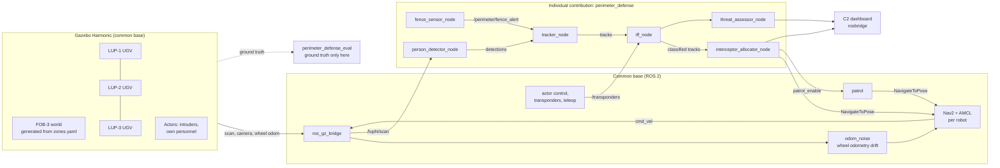

# Autonomous Interception of Physical Threats in Military Perimeters using ROS 2 and Nav2

Master's project (Industry 4.0 / ROS 2, UNSTPB). Three outdoor UGVs patrol a
simulated forward operating base (FOB-3) in Gazebo while own personnel move
around the base. Intruders enter through breaches in the fence and head for the
ammunition depot. The system detects people from on-board sensor data, tells
own personnel from intruders, tracks them with Kalman filters, predicts their
motion and coordinates the robots to intercept them before they reach the
depot.

The project extends the topic of the author's dissertation (an information
system for the analysis, control and processing of security incidents) to the
physical security side.

> Exercise only. All data is simulated. The base, Baza Militară "Căpitan Ion
> Vulturescu" (code name FOB-3, Centrul de Comandă Sector Nord), the officer it
> is named after and its location are fictional and do not correspond to any
> real military site.

## Status

| Milestone | Content | Status |
|---|---|---|
| M1 | Realistic world, generated Nav2 maps, one UGV with Nav2 + AMCL patrolling waypoints | done |
| M2 | Intruder actor, fence sensor, lidar person detector, tracker, one robot following the track | planned |
| M3 | Predictive interception with one robot, naive mode, RViz markers | planned |
| M4 | Three namespaced robots, role allocation, scenario S1 | planned |
| M5 | Own personnel, transponders, IFF (scenario S2) | planned |
| M6 | Multi-target tracking, two intruders, diversion (S3, S4) | planned |
| M7 | Batch evaluation, CSV and plots | planned |
| M8 | C2 web dashboard via rosbridge, manual intruder control | planned |

## Architecture



The algorithm nodes only use simulated sensor data (lidar, camera, odometry,
transponders). Ground truth poses from Gazebo are used exclusively by the
evaluation package for metrics.

## Packages

| Package | Role | Owner |
|---|---|---|
| `perimeter_defense_world` | `zones.yaml` (single source of truth), world generator, Nav2 map generator, top-down render, textures, actor meshes | common base |
| `perimeter_defense_description` | LUP UGV description (Jackal-sized skid-steer, gpu_lidar, camera) | common base |
| `perimeter_defense_bringup` | Launch files, Nav2 and fleet configuration, RViz | common base |
| `perimeter_defense_sim` | Odometry drift, baseline patrol; later actors, transponders, manual intruder | common base |
| `perimeter_defense_viz` | Tactical RViz overlay: aerial background, grid, fence and breaches, objective, zones, routes, fleet symbols | common base |
| `perimeter_defense_msgs` | Track, TrackArray, ThreatLevel, Alert, RoleAssignment, Transponder | M2+ |
| `perimeter_defense` | Detection, IFF, tracking and prediction, interceptor allocation | **individual contribution**, M2+ |
| `perimeter_defense_eval` | Headless batch runs, CSV, plots | M7 |
| `dashboard` | C2 web interface | M8 |

## Nodes and topics (implemented so far)

| Node | Namespace | Subscribes | Publishes |
|---|---|---|---|
| `gazebo` (gz sim) | | `/lupN/cmd_vel` | `/lupN/scan`, `/lupN/odom_wheel`, `/lupN/joint_states`, `/lupN/camera/*`, `/clock` |
| `map_server` | / | | `/map` (navigation map, solid fence) |
| `map_server_localization` | / | | `/map_localization` (AMCL map, fence posts only) |
| `robot_state_publisher` | /lupN | `joint_states` | `/tf`, `/tf_static` (frames `lupN/...`) |
| `odom_noise` | /lupN | `odom_wheel` | `odom`, `/tf` (`lupN/odom` -> `lupN/base_link`) |
| `amcl` | /lupN | `scan`, `/map_localization` | `amcl_pose`, `/tf` (`map` -> `lupN/odom`) |
| Nav2 (controller, planner, behaviors, bt_navigator) | /lupN | `scan`, `odom`, `/map`, `speed_limit` | `cmd_vel`, `plan` |
| `patrol` | /lupN | `patrol_enable` | `navigate_to_pose` goals, `speed_limit` |
| `layout_markers` | / | | `/perimeter/layout_markers` (latched) |
| `fleet_markers` | / | `/tf` | `/fleet/markers` |

## Environment

Target: Ubuntu 24.04, ROS 2 Jazzy, Gazebo Harmonic (`ros_gz`), Nav2.

```bash
sudo apt install ros-jazzy-desktop ros-jazzy-navigation2 ros-jazzy-nav2-bringup \
  ros-jazzy-ros-gz ros-jazzy-xacro ros-jazzy-rosbridge-server \
  python3-numpy python3-scipy python3-yaml python3-pil python3-matplotlib python3-pytest
```

On WSL2, Gazebo renders the lidar and the camera through OpenGL; use WSLg with
an up-to-date GPU driver for Windows.

## Build

```bash
mkdir -p ~/fob3_ws/src && cd ~/fob3_ws/src
git clone <this repository> ros2-perimeter-interception
cd ~/fob3_ws
rosdep install --from-paths src --ignore-src -y
colcon build --symlink-install
source install/setup.bash
```

## M1: world, map and one patrolling UGV

```bash
# Gazebo GUI + RViz, LUP-1 patrols route R1 at 0.8 m/s
ros2 launch perimeter_defense_bringup m1_patrol.launch.py

# Options
ros2 launch perimeter_defense_bringup m1_patrol.launch.py world_variant:=night
ros2 launch perimeter_defense_bringup m1_patrol.launch.py headless:=true enable_camera:=false
ros2 launch perimeter_defense_bringup m1_patrol.launch.py start_patrol:=false   # drive with RViz "2D Goal Pose"
```

What to check:
- Gazebo: the robot drives the loop (3.5,24.5) -> (14,24.5) -> (13.5,15) -> (3.5,15).
- RViz (tactical view): aerial background, grid, breaches, objective; LUP-1 is shown
  as a blue friendly UGV symbol with call sign, heading and its 10 m detection ring;
  the laser scan (cyan) lines up with the building edges.
- `ros2 topic hz /lup1/scan` gives about 10 Hz.
- Real-time factor in the Gazebo GUI (bottom right) stays close to 1.0.

Check that actors are visible on gpu_lidar in your Gazebo install:

```bash
ros2 run perimeter_defense_world check_actor_lidar     # prints PASS / FAIL
```

Regenerate the world, the maps and the top-down images after editing
`perimeter_defense_world/config/zones.yaml` (run from the package directory):

```bash
cd src/ros2-perimeter-interception/perimeter_defense_world
ros2 run perimeter_defense_world generate_world --zones config/zones.yaml --out worlds --textures models/fob3_textures/textures
ros2 run perimeter_defense_world generate_map --zones config/zones.yaml --out maps/fob3
ros2 run perimeter_defense_world render_ortho --variant day --worlds worlds --models models --out maps/fob3_ortho_day.png
```

Unit tests:

```bash
colcon test --packages-select perimeter_defense_world && colcon test-result --verbose
# or, without ROS:
python3 -m pytest perimeter_defense_world/test
```

## Design notes (M1)

**Robot.** The Clearpath simulator does support Jazzy/Harmonic, but it
generates the robot, bridges and Nav2 setup from its own `robot.yaml` and
directory layout. A custom URDF (`lup_ugv.urdf.xacro`) with the Jackal
footprint (0.51 x 0.43 m), mass (~17 kg) and top speed (2.0 m/s) gives full
control over sensor noise, namespaces and frames, and is lighter to run three
times. Sensors: 360 degree gpu_lidar (720 beams, 10 Hz, gaussian noise 2 cm) on
a 0.85 m mast so the scan plane crosses a person's torso, and a 640x480 RGB
camera.

**Skid-steer calibration.** With default friction, a four-wheel skid-steer
base in DART barely turns. The wheels use a friction direction along the axle
(low lateral friction 0.3, rolling friction 1.0) and an effective wheel
separation of 1.12 x track. Measured in simulation: commanded 172 degrees ->
172 degrees, commanded arc 115 degrees -> 114.6 degrees, 2 m/s straight -> 5.56 m in 3 s.

**Odometry with drift.** The Gazebo DiffDrive odometry is almost perfect.
`odom_noise` re-integrates it with a per-run scale error (1.5 %), a heading
bias (0.004 rad/m) and motion-proportional noise. AMCL corrects the drift.

**Actors on lidar.** Checked with `check_actor_lidar` on Gazebo Harmonic 8.10:
an animated actor walking at 1.3 m/s is seen in 98 % of scans at the right
position, so intruders and own personnel are animated actors (walk / run
skins), not cylinders.

**Fence and lidar.** The chain-link mesh is visible to cameras but carries a
visibility flag that the lidar masks out, so the lidar sees through the fence
(only the posts return) like a real lidar. Buildings block both. Consequently
there are two maps generated from the same geometry: `/map` with a solid
fence for planning, and `/map_localization` with posts only for AMCL.

**AMCL sensor model.** The likelihood-field model only scores beam endpoints;
in this open base with a see-through fence it locked onto wrong modes (up to
1.5 m off). The beam model also uses free space and max-range readings. Over
three patrol laps the AMCL error against ground truth was 0.27 m on average
and 0.57 m at most (measured with a diagnostic script, ground truth is not
used by any node).

**Setting.** The base sits in a fictional stretch of the Romanian plain:
farmland strips (wheat, maize, sunflower, rapeseed, ploughed soil), a county
road with an access road to the main gate, an irrigation canal and acacia
windbreaks. Buildings follow local military architecture: plastered walls with
tiled or tin gable roofs, an arched hangar, concrete slab roads, concrete fence
posts with concertina wire and a flagpole. Everything outside the fence is
visual only and outside the Nav2 map; tree rows are kept at least 12 m from
the fence, so they never fall inside a robot's 10 m detection radius (checked
by a unit test). The name and the surroundings are set in `zones.yaml`.

**Tactical view.** The robot keeps its real Jackal size in the simulation;
RViz shows it with an enlarged friendly unit symbol (3 x 2 m), as a C2 map
would. The RViz background is the top-down render of the Gazebo world on a
textured plane, so the map in RViz looks like the simulated base.

**Performance.** With one robot, the camera off and software rendering on a
4-core machine without GPU, the real-time factor is 0.99.

## Individual contribution

The individual contribution of the author is the `perimeter_defense` package
(implemented from M2 on):

- `fence_sensor_node`
- `person_detector_node`
- `iff_node`
- `tracker_node`
- `interceptor_allocator_node`
- `threat_assessor_node`

The world, robot model, Nav2 configuration, simulation helpers (actors,
transponders, odometry drift, patrol) and the bringup are the common base.
